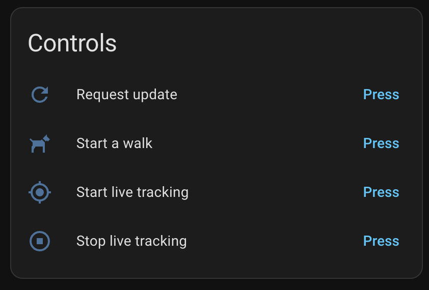
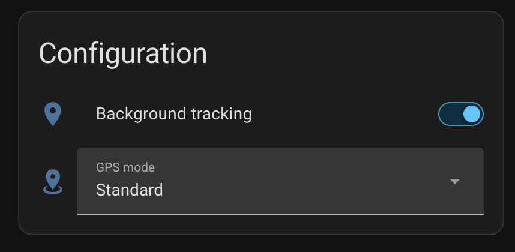
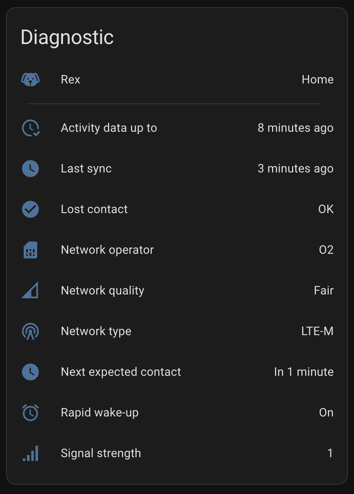
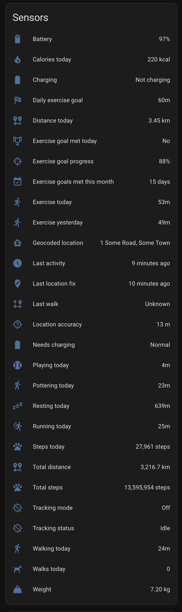

# PitPat for Home Assistant

A custom integration that brings your PitPat dog activity monitor data into Home Assistant.

> This is an unofficial project. It is not affiliated with, endorsed by or supported by PitPat. It uses PitPat's private app API, which may change or stop working at any time.

It signs in with the same email and password as the PitPat app. The password is used once to sign in and is never stored; the integration keeps only a refresh token, and asks you to sign in again if that stops working.

## Installation

### From the Marketplace

[](https://my.home-assistant.io/redirect/marketplace_repository/?owner=photomoose&repository=ha-pitpat&category=integration)

Until PitPat is listed in the Marketplace, add `https://github.com/photomoose/ha-pitpat` under **Settings → Marketplace → Custom repositories** (category **Integration**), then install **PitPat**. On Home Assistant 2026.10 or older, do the same in HACS and restart Home Assistant afterwards.

Then go to **Settings → Devices & services → Add integration** and search for **PitPat**.

### Manually

1. Copy `custom_components/ha_pitpat` into the `custom_components` folder of your Home Assistant configuration directory (the folder that holds `configuration.yaml`).
2. Restart Home Assistant.
3. Go to **Settings → Devices & services → Add integration** and search for **PitPat**.

## What you get

One device per dog (named after the dog), with:

| Entity | Description |
| --- | --- |
| Start live tracking (button) | Starts live tracking to find the dog. Home Assistant keeps it going, as the app does while its map is open, until it's stopped or for at most three hours |
| Start a walk (button) | Starts a walk, which also puts the collar into live tracking |
| Stop live tracking (button) | Ends live tracking, whether started as a walk or to find the dog |
| Request update (button) | Asks the collar to report in now rather than at its next check-in, as the app does when it opens. PitPat sends this to all the account's collars. Home Assistant then checks every 30 seconds, for up to 3 minutes, and refreshes all the sensors as soon as the collar reports |
| Background tracking (switch) | Turns the collar's background location tracking on or off. Like GPS mode, Home Assistant shows the new setting until the collar reports it. |
| GPS mode (select) | How often the collar checks in: Economy (least battery, but slowest to start live tracking), Standard, or Urgent (most battery, quickest to start). A change may take until the collar next reports in to show up in PitPat; Home Assistant shows the new mode meanwhile. |
| Device tracker | Last known GPS position of the collar, with accuracy |
| Exercise / Pottering / Resting today | Minutes of each so far today (the dog's local day) |
| Walking / Running / Playing today | Minutes of each kind of exercise so far today |
| Steps today | Steps counted so far today |
| Distance today | Distance covered so far today |
| Calories today | Calories burned so far today (kcal) |
| Total steps | Lifetime step count from the collar; good for long-term statistics |
| Total distance | Lifetime distance in km |
| Activity data up to | Time of the latest activity data PitPat has received (diagnostic) |
| Exercise goal progress | Today's exercise as a percentage of the goal |
| Exercise goal met today | On once today's goal is reached |
| Exercise yesterday | Yesterday's final exercise minutes |
| Exercise goals met this month | Days this month the goal was met |
| Battery | Collar battery level (%) |
| Charging | Whether the collar is charging |
| Needs charging | On when PitPat says the collar needs charging (the check behind the app's low battery notice) |
| Weight | The dog's weight in kg, as entered in the app |
| Daily exercise goal | Today's exercise goal in minutes |
| Last activity | When the collar last recorded activity |
| Last sync | When the collar last reported in (diagnostic) |
| Next expected contact | When the collar is next due to report (diagnostic) |
| Geocoded location | Street address at the last known position, looked up from OpenStreetMap when the dog has moved 50 m or more. Attributes hold the full address, street, locality, postcode and country. See the privacy note below |
| Last location fix | When the collar took its last location fix |
| Location accuracy | How accurate the last location fix is, in metres |
| Walks today | Number of walks so far today; refreshed after each report, and every 5 minutes during a walk |
| Last walk | When today's latest walk ended. Attributes hold its start, duration, vicinity and, once PitPat has worked them out, steps, distance (m) and calories |
| Tracking mode | Off, Live tracking or Walk |
| Tracking status | Progress of a walk or live tracking, as the app shows it: Idle, Waiting for next contact (the collar hasn't picked up the request yet), Listening to satellites (it has, and is getting a GPS fix) or Live tracking (fixes are coming in) |
| Lost contact | On when PitPat has lost contact with the collar (diagnostic) |
| Network quality | Mobile signal quality as the app names it: Minimal, Poor, Fair, Good or Great, or Pending until the collar reports it (diagnostic) |
| Signal strength | 0 to 4, like the bars on a phone. The app doesn't show it, and it doesn't follow Network quality, so it probably measures something else, such as raw signal level (diagnostic, disabled by default) |
| Network operator | Mobile network the collar uses (diagnostic, disabled by default) |
| Network type | Mobile network technology: LTE-M or NB-IoT (diagnostic, disabled by default) |
| Rapid wake-up | Shown as "[+]" after the network type in the app. Probably whether PitPat can wake the collar straight away on its current connection, rather than at its next check-in (diagnostic, disabled by default) |

Collars report in roughly every 20 minutes (less often in Economy GPS mode). The integration checks the collar's status every 5 minutes, and only fetches the activity and other data once the collar has reported, as nothing else changes in between. It also fetches everything at least once an hour, and when the dog's day changes, to pick up changes made in the app. During a walk or live tracking the integration also connects to PitPat's live updates service, the same one the app's map uses, so each location the collar reports (about every 30 seconds) appears straight away. While connected, the collar's status is also polled every 2 minutes as a fallback; if the connection can't be made or drops, or a poll finds a report the connection missed, polling goes back to every 30 seconds and it reconnects. When tracking ends, PitPat says so over the connection, which then closes, and polling returns to normal.

PitPat ends a walk by itself after three hours. Live tracking to find the dog ends 10 minutes after the last "keep-alive", which the app sends every 30 seconds while its map is open. Home Assistant sends them for live tracking it started (not for tracking started in the app), until tracking is stopped or for at most three hours.

Starting a walk or live tracking wakes the collar, which can take a few minutes (longer in Economy GPS mode, less in Urgent); the integration polls quickly for up to 10 minutes while it waits. Tracking status shows how far it has got. Live tracking uses a lot of collar battery, so if you put the start buttons on a dashboard, consider adding a tap confirmation to the card.

## Screenshots

The device page for a dog:

<table>
  <tr>
    <td valign="top" width="50%">
      
      
      
    </td>
    <td valign="top" width="50%">
      
    </td>
  </tr>
</table>

## Notes

- PitPat locks sign-in for 10 minutes after several failed attempts. The integration never retries a failed sign-in by itself.
- This integration uses PitPat's private app API, which may change without notice.

## Development

```sh
python3 -m venv .venv
.venv/bin/pip install -r requirements_test.txt
.venv/bin/pytest
```

`scripts/try_login.py` exercises the sign-in flow and API without Home Assistant.

## Licence

MIT. See [LICENSE](LICENSE). PitPat is a trademark of its owner and is used here only to say what the integration works with.

### Privacy

The Geocoded location sensor sends the dog's coordinates to OpenStreetMap's Nominatim service (nominatim.openstreetmap.org) to look up the address. Nothing else is sent: no PitPat account details, tokens or dog names. To stop these lookups, disable the Geocoded location entity.
